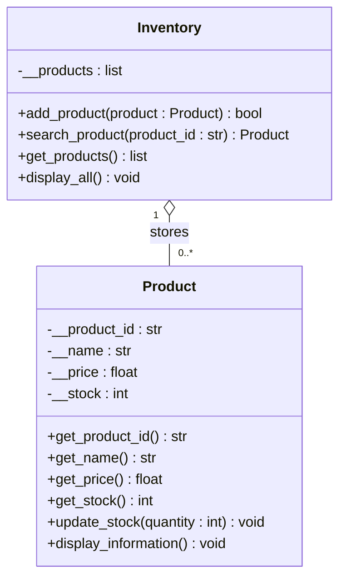

# Lab 6 – UML Class Diagram



ASCII version:

```
+---------------------------------------+     +----------------------------------------+
| Product                               |     | Inventory                              |
+---------------------------------------+     +----------------------------------------+
| - __product_id : str                  |     | - __products : list[Product]           |
| - __name : str                        |     +----------------------------------------+
| - __price : float                     |     | + add_product(product : Product):bool |
| - __stock : int                       |     | + search_product(id : str) : Product   |
+---------------------------------------+     | + get_products() : list                |
| + get_product_id() : str              |     | + display_all() : void                 |
| + get_name() : str                    |     +----------------------------------------+
| + get_price() : float                 |<>-----------------------------------| 1 .. 0..*
| + get_stock() : int                   |
| + update_stock(quantity : int) : void |
| + display_information() : void        |
+---------------------------------------+
```

# Reflection Questions

1. **Class vs object:** A class is the blueprint (Product); an object is a specific instance built from it, e.g. `Product("P001", "Laptop", 1200.00, 15)`.
2. **Why Product:** Product is a clear noun in the system with its own data and behaviour, and the inventory holds many of them.
3. **Data in a Product:** product ID, name, price and stock quantity.
4. **Product manages its own stock:** So it can validate changes (e.g. reject negative stock) in one place; the main program can't put the object into an invalid state.
5. **Encapsulation:** Attributes are private (`__stock` etc.) and are read/changed only through public methods such as `get_stock()` and `update_stock()`.
6. **Product responsibility:** Represent and manage a single product (store its information and manage its own state).
7. **Inventory responsibility:** Manage a collection of products: store, add, search and display them.
8. **SRP:** Each class has one reason to change: Product changes if product rules change, Inventory if collection handling changes, main if the menu/I/O or file format changes.
9. **What main needs to know:** The Product's public interface – its constructor arguments and public methods (`get_name()`, `update_stock()`, etc.).
10. **What main doesn't need to know:** How the data is stored internally (private attributes, name mangling, validation details), which could change without affecting the main program.
